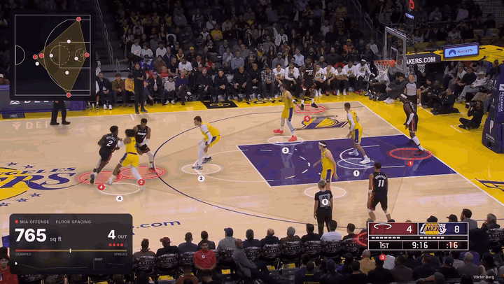
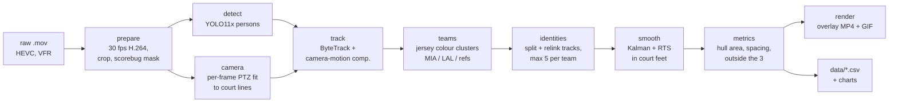
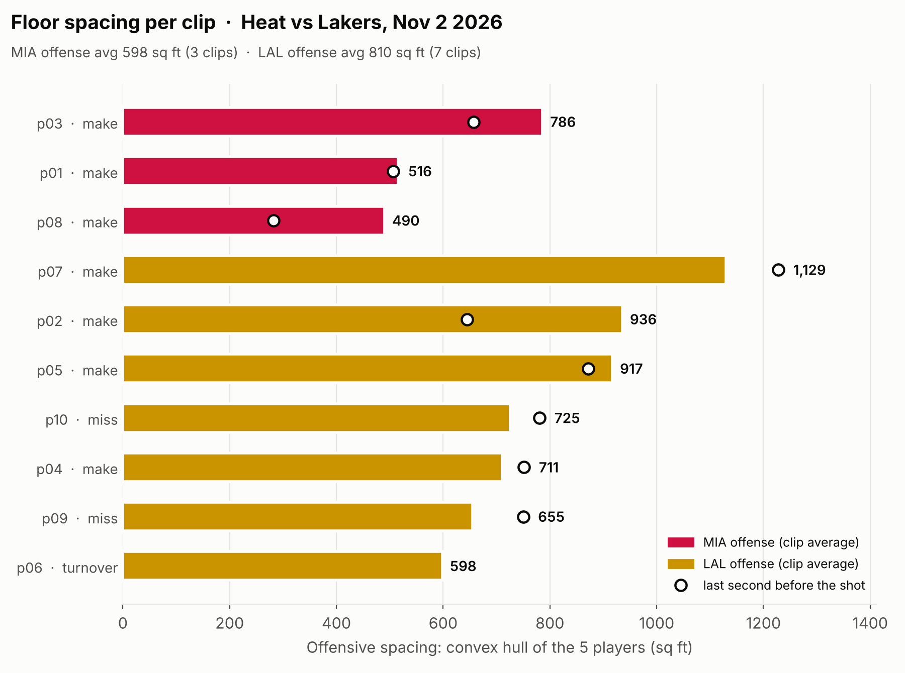
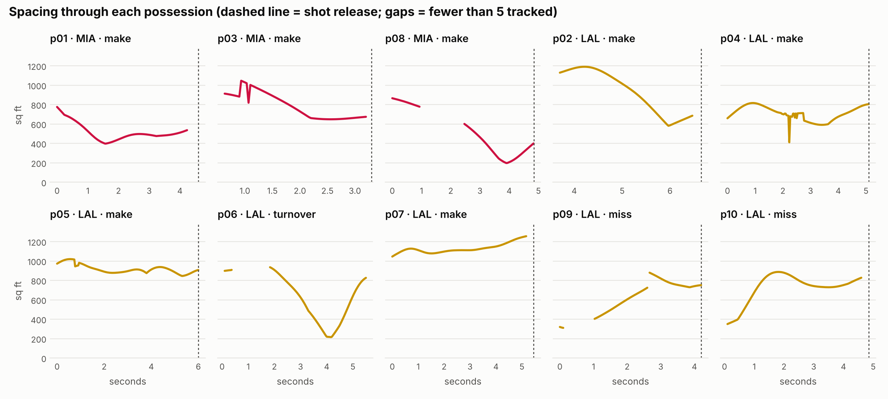

# floorspace



**How well is an NBA offense spaced, frame by frame, from nothing but the TV broadcast?**

floorspace tracks all ten players in a broadcast clip, maps them onto a top-down court in feet,
measures how spread out the five offensive players are, and renders a broadcast-style overlay: rings on
the floor, a live spacing polygon that runs from red (cramped) to green (spread), a minimap and a stat panel.
It runs on a laptop CPU. It doesn't use tracking data, manual labels or cloud APIs.

Ten clips from **Heat vs Lakers, Nov 2 2026** are processed end to end. All numbers below come from those clips.

---

## How it works



| Stage | What it does |
|---|---|
| **prepare** | ffprobe the phone recordings, convert to 30 fps constant-frame-rate H.264, crop to the broadcast picture, record the scorebug box so it is ignored downstream. |
| **camera** | The broadcast camera sits in a fixed spot and only pans, tilts and zooms. Its position is estimated once (`data/camera.json`), then every frame is fitted by matching the projected court model to the white lines and the purple 3-point line. Frame-to-frame optical flow predicts the next frame, and a Savitzky–Golay filter removes jitter. |
| **detect + track** | YOLO11x finds people, ByteTrack links them, with the Kalman state warped by the camera motion so pans don't break tracks. Boxes whose feet aren't on the court, or whose size doesn't fit a person at that spot, are dropped (bench, crowd). |
| **teams** | Torso / shorts / leg colours (floor pixels removed using a clean plate of the court) are clustered into Heat, Lakers and referees with one model fitted on all clips. Tracks are split where the label flips and relinked per team, so ID switches don't mix teams. |
| **smooth** | Feet positions in court feet go through a constant-velocity Kalman filter + RTS smoother. Gaps up to 0.8 s are bridged; lost players are held briefly, then faded. Players hidden behind the scorebug get their feet estimated from their head height. |
| **metrics** | Computed only when all five offensive players are tracked; otherwise the frame is flagged and left blank. |
| **render** | Floor graphics are drawn in court coordinates and projected into each frame, then cut out with player segmentation masks so they sit *under* the players. Rendered at 2× supersampling in Inter. |

## Metrics

All distances are on the court floor, in feet (court 94 × 50 ft).

| Metric | Definition |
|---|---|
| **Spacing (sq ft)** | Area of the convex hull around the five offensive players' feet. A half court is ~2,350 sq ft. |
| **Mean teammate distance (ft)** | Average of the 10 pairwise distances between the five offensive players. |
| **# outside the 3** | Offensive players behind the 3-point line (23.75 ft arc, 22 ft in the corners; on the line counts as inside). |
| **Per clip** | Average and minimum inside the analysis window (from the start of the half-court set to the shot release, `clips/clips.csv`), plus the average over the **last 1 s before the shot**. |
| **Colour scale** | The polygon is red at **426 sq ft** and green at **1,111 sq ft**: the 10th and 90th percentile of every tracked frame across all ten clips (`data/spacing_thresholds.json`). |

## Results



| | Heat offense (3 clips) | Lakers offense (7 clips) |
|---|---:|---:|
| Avg spacing | **598 sq ft** | **810 sq ft** |
| Avg teammate distance | 26.8 ft | 30.0 ft |
| Avg players outside the 3 | 3.0 | 3.3 |

- **The Lakers spaced the floor wider in this sample**: about 35 % more hull area and 3 ft more between teammates
  on average. Their widest possession (p07, 1,129 sq ft) ended in a make, with the spacing still *growing*
  into the shot (1,228 sq ft in the last second).
- **The Heat scored from tight shapes.** p01 and p08 averaged about 500 sq ft; p08 shrank below 200 sq ft
  a second before the make.
- **The turnover (p06) has the deepest dip:** spacing fell from ~930 to ~215 sq ft mid-possession before
  the Lakers spread out again.
- With 10 clips (3 Heat) none of this is statistically meaningful. It shows what the pipeline measures, not
  a scouting conclusion.



Per-clip numbers are in [`data/clips_summary.csv`](data/clips_summary.csv).

## Tracking quality

Share of analysis-window frames with all five offensive players tracked (observed or bridged across a short gap).
Frames below five aren't scored. Counts never exceed five per team, and the hull never exceeds a half court.

| clip | p01 | p02 | p03 | p04 | p05 | p06 | p07 | p08 | p09 | p10 |
|---|---|---|---|---|---|---|---|---|---|---|
| offense | MIA | LAL | MIA | LAL | LAL | LAL | LAL | MIA | LAL | LAL |
| all 5 tracked | 92 % | 94 % | 78 % | 100 % | 100 % | 72 % | 95 % | 69 % | 78 % | 93 % |

The main reasons for misses are players off-screen when the camera is zoomed in (p02, p06), a player standing
behind the scorebug (p03), and deep pile-ups at the rim (p08, p09). Full counts are in [`data/qa_report.csv`](data/qa_report.csv);
court-line check videos are in [`outputs/debug/`](outputs/debug).

## Data

Plain CSVs, ready for SQL or Power BI.

**`data/tracking.csv`**: one row per player per frame

| column | meaning |
|---|---|
| clip, frame, t_sec | clip id, frame at 30 fps, seconds from clip start |
| track_id | player id within the clip (stable after relinking) |
| team, side | MIA / LAL, offense / defense |
| x_ft, y_ft | court position in feet: x 0–94 along the court, y 0–50 across |
| visible | 1 = seen by the detector this frame, 0 = bridged by the smoother |

**`data/spacing.csv`**: one row per frame: `clip, frame, t_sec, offense, attack_side, in_window,
n_offense_tracked, all5_tracked, hull_area_sqft, mean_dist_ft, n_outside_3`

**`data/clips_summary.csv`**: one row per clip: avg / min / last-1 s of each metric, share of frames with all five tracked.

**`clips/clips.csv`**: hand-entered clip notes: offense, defense, result, game clock, analysis window and shot time.

## Outputs

- `outputs/pNN_floorspace.mp4`: overlay video for every clip (H.264, broadcast resolution)
- `outputs/debug/pNN_court_check.mp4`: projected court lines over the raw video, to check the camera fit
- `docs/hero.gif`: the loop at the top of this page

## Run it

Python 3.12+ and ffmpeg. CPU only. The full run of ten clips takes a few hours, mostly detection and
segmentation; every stage is cached under `work/`.

```bash
python -m venv .venv && . .venv/bin/activate
```

```bash
pip install -r requirements.txt && pip install -e .
```

Model weights (`yolo11x.pt`, `yolo11l-seg.pt`) are downloaded into `weights/` from the
[Ultralytics GitHub releases](https://github.com/ultralytics/assets/releases).

```bash
python -m floorspace prepare                 # clips/raw/*.mov -> clips/mp4/*.mp4
```

```bash
python -m floorspace run clips/raw/p01.mov   # one clip, end to end
```

```bash
python -m floorspace run-all                 # every clip in clips/clips.csv + data, charts, videos, GIF
```

```bash
python -m floorspace qa p01 -n 12            # court-check video + sampled QA frames with minimap
```

Rerun from a stage with `--force-from camera|track|features|identities|smooth`.

## Limitations

- **Small sample:** 10 possessions from one game, only 3 with Miami on offense.
- **Single camera angle:** the camera model assumes the main broadcast camera. Replays, close-ups and
  baseline angles aren't handled, so clips have to stay on the wide shot.
- **Off-screen players:** when the camera zooms in, weak-side players leave the picture and the frame isn't
  scored rather than guessed.
- **Feet, not bodies:** positions are the bottom-centre of each detection box, so a jumping or leaning player
  is a foot or two off.
- **Team colours are fitted per game:** a new game with different uniforms needs the team model refitted
  (`run-all` does this automatically).
- **No ball tracking:** the ball was detected in only ~28 % of frames on p01, so the ball trail is left out.
- **Input is a phone recording of a TV:** moiré and variable frame rate cost some accuracy; a direct broadcast
  feed would be cleaner.

---

Built by **Viktor Berg**.
